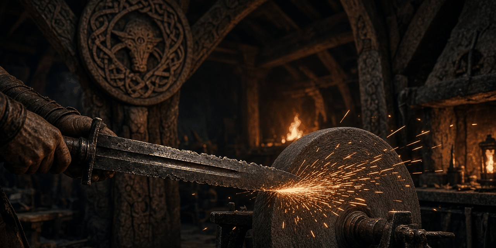

# Scarred Steel

Combat wears your weapon and your armor. Repair a weapon at a grindstone and armor at a workbench. The items themselves are not changed.

**Status: v0.2.0, early beta.** It passes every automated check in the build (Papyrus compile, plugin validation, byte-exact round trip, SEQ check, FOMOD schema) but has not been playtested in game yet. Expect rough edges and please report what you find. See [docs/TESTING.md](docs/TESTING.md).

- Game: Skyrim Special Edition / Anniversary Edition 1.6.x (1.5.97 also works). Runs on Windows, and on Linux through Proton.
- Requirements: just the base game. No SKSE, SkyUI, DLC or Creation Club content.
- Plugin: `ScarredSteel.esp`, ESL-flagged, with Skyrim.esm as its only master. **It edits no vanilla records.** Nothing is placed in the world. It adds no cells.
- Works with the rest of the series ([Blackshield Company](https://github.com/Blackshield-Company/blackshield-company), [Bounties of Oblivion](https://github.com/Blackshield-Company/bounties-of-oblivion), [Contract Hunter](https://github.com/Blackshield-Company/contract-hunter), [Steel Oath](https://github.com/Blackshield-Company/steel-oath), [Ember Smithing](https://github.com/Blackshield-Company/ember-smithing), [The Gray-Mane Debt](https://github.com/Blackshield-Company/the-gray-mane-debt), [Blackshield Codex](https://github.com/Blackshield-Company/blackshield-codex), [War Banners](https://github.com/Blackshield-Company/war-banners), [Roadwarden](https://github.com/Blackshield-Company/roadwarden), [Sellsword Roster](https://github.com/Blackshield-Company/sellsword-roster), [The Turncoat Contract](https://github.com/Blackshield-Company/the-turncoat-contract), [The Ledger of Ash](https://github.com/Blackshield-Company/the-ledger-of-ash), [Oathbreaker's Price](https://github.com/Blackshield-Company/oathbreakers-price), [Champion's Reforge](https://github.com/Blackshield-Company/champions-reforge), [Barrow-Iron Pact](https://github.com/Blackshield-Company/barrow-iron-pact), [Company Quartermaster](https://github.com/Blackshield-Company/company-quartermaster)). It has its own prefix (`SCS_`), records, globals and files. See [tools/modkit](tools/modkit/README.md).

## Install

Use the FOMOD. It installs `ScarredSteel.esp`, the scripts, and `SEQ/ScarredSteel.seq`. Papyrus sources are optional. Enable the plugin. It is ESL-flagged, so it does not take a full load-order slot. Load order does not matter: it has no master but Skyrim.esm and it overrides nothing.

## How it works

Wear is two counters on the player, weapon and armor. It is not stored on the item. Vanilla Papyrus cannot tag individual items, so a swapped sword keeps the same weapon wear.

1. At the start you learn the lesser power **Inspect Gear** and see a short note once (`SCS_IntroShown`).
2. **Weapon wear.** A `weaponSwing`, `weaponLeftSwing`, or `arrowRelease` animation adds 1, and only while you are in combat. The alias registers for those events on start, on load, and on a location change, because a graph reload can drop the registration.
3. **Armor wear.** A hit whose source is a weapon, or that carries a projectile, adds 1 while you wear a body piece with `ArmorCuirass`. A power attack adds 2. Hits closer than `SCS_HitCooldown` (0.5) real seconds are ignored. The check uses `Utility.GetCurrentRealTime()`. There is no timer.
4. **Tiers.** The counter is compared to console globals. Only the current tier's ability is on you. A notice appears only when the tier changes, and only if wear hints are on (`SCS_WearHints`). Counters stop at the tier 3 threshold.

| Weapon tier | Name | At | Effect |
|---|---|---|---|
| 0 | Keen | below 60 | none |
| 1 | Nicked | 60 | weapon damage −5% |
| 2 | Dulled | 150 | weapon damage −12% |
| 3 | Blunted | 260 | weapon damage −20% |

| Armor tier | Name | At | Effect |
|---|---|---|---|
| 0 | Sound | below 40 | none |
| 1 | Scuffed | 40 | armor rating −15 |
| 2 | Dented | 100 | armor rating −40 |
| 3 | Battered | 180 | armor rating −80 |

The penalties are ability spells. Each is a Value Modifier flagged Detrimental and Recover, with a positive magnitude, so the game subtracts it and removes it when the spell is removed.

5. **Hardened.** After an ember repair, `SCS_WeaponHardened` or `SCS_ArmorHardened` is 1. Only every second qualifying event counts, until the next repair of that kind.
6. **Repair.** Use a grindstone (`CraftingSmithingSharpeningWheel`) with weapon wear above 0, or a workbench (`CraftingSmithingArmorTable`) with armor wear above 0. The menu offers Repair, Ember repair (only if Ember Smithing is loaded), and Not now.

| | Iron ingot | Leather strips | Also, for ember | Result |
|---|---|---|---|---|
| Weapon | 1 | 1 | 2 charcoal, 1 fire salts | Smithing ≥ `SCS_FullRepairSkill` (30) clears it. Otherwise the counter drops one tier (tier 1 goes to 0). Ember always clears it and sets Hardened. |
| Armor | 1 | 2 | 2 charcoal, 1 fire salts | Same. |

Missing materials show a notice. A normal repair clears Hardened for that kind. Ember Smithing is not a master. On start and on every load the quest does `Game.GetFormFromFile(0x803, "EmberSmithing.esp")` and sets `SCS_EmberPresent`.

7. **Inspect Gear** shows weapon wear, weapon tier, armor wear, armor tier, both hardened flags, and whether wear hints are on, with the tier names in the text. It can turn wear hints off or on.

No `RegisterForUpdate`. Tier changes happen on the swing, hit, repair, and load events only.

## Settings (console)

```
set SCS_WeaponTier1 to 60         ; weapon wear for Nicked
set SCS_WeaponTier2 to 150        ; Dulled
set SCS_WeaponTier3 to 260        ; Blunted; also the cap
set SCS_ArmorTier1 to 40          ; armor wear for Scuffed
set SCS_ArmorTier2 to 100         ; Dented
set SCS_ArmorTier3 to 180         ; Battered; also the cap
set SCS_HitCooldown to 0.5        ; real seconds between counted armor hits
set SCS_FullRepairSkill to 30     ; Smithing at or above this clears the counter
set SCS_WearHints to 1            ; 1 shows tier notices, 0 hides them
```

State, also console-adjustable, but the script overwrites these on the next event or load: `SCS_IntroShown`, `SCS_EmberPresent` (1 when Ember Smithing is loaded), `SCS_WeaponHardened`, `SCS_ArmorHardened`.

Read-only mirrors, written by the script: `SCS_WeaponWear`, `SCS_ArmorWear`, `SCS_WeaponTierNow`, `SCS_ArmorTierNow`. Read them to see the state. A console edit is picked up on the next swing, hit, repair, inspect, or load. The script then overwrites them.

## How it differs from Ember Smithing and Company Quartermaster

Ember Smithing makes new weapon and armor variants (heat-tempering and engraving) at the forge. It has no wear, no durability, and no scripts. Scarred Steel does not create, swap, or edit items, so those variants, enchantments, and tempering are left alone.

Company Quartermaster's "Repair gear" is Brynja's field refit: a timed follower buff (+40 armor, +10% weapon damage) bought with leather strips, an iron ingot, and gold. It is not wear, and it is followers only. Scarred Steel does not touch followers and has no vendor.

Scarred Steel is player-only wear on two counters, repaired by using a vanilla grindstone or workbench. If Ember Smithing is installed, ember repair spends vanilla charcoal and fire salts and hardens the counter so wear builds at half rate until the next repair. That is not a timed buff, and this mod does not master Ember Smithing.

## Compatibility

No shared records with the other mods in the series. Prefix `SCS_`. No vanilla overrides, no placed references, no new cells. Ember Smithing is optional and is not a master. Followers are not affected.

## Known issues (early beta)

- Not playtested in game.
- Wear is two counters, weapon and armor, not a value on each item. Vanilla Papyrus cannot tag individual items. Swapping weapons does not reset weapon wear. A bow and a sword share the weapon counter. Helmets, gloves, boots, and shields are not tracked; armor wear counts only while a piece with `ArmorCuirass` is worn.
- Swings count only in combat. The swing that starts a fight may not count. Unarmed, most spells, and falls do not wear armor. Only a weapon source or a projectile does.
- A power attack is one event. While Hardened, that event either counts as 2 or is skipped. It is not halved to 1.
- Animation registrations can drop when the graph reloads. The alias re-registers on init, on load, and on a location change. A swing in that same moment can be missed.
- The repair menu uses OnSit. The vanilla crafting menu may also open. Chairs, forges, and enchanting tables do not offer repair.
- Nothing is placed in the world. There is no per-frame script.

## Building

`./build.sh` on Linux builds the release zip from this repo. Papyrus is compiled with the open-source [papyrus-compiler](https://github.com/russo-2025/papyrus-compiler), the plugin is generated from C# with [Mutagen](https://github.com/Mutagen-Modding/Mutagen), and everything is validated. You need .NET SDK 9+, python3, curl and, optionally, xmllint. See [tools/modkit/README.md](tools/modkit/README.md).

## Layout

```
src/plugin/ScarredSteel.Generator/   C# generator (quest, power, abilities, messages, settings)
src/plugin/formids.json              pinned FormIDs
src/papyrus/                         controller, power and player alias scripts
fomod/                               FOMOD installer config
tools/modkit/                        shared build tooling (Mutagen helpers, validator, Papyrus, FOMOD, compat check)
docs/                                design notes, testing checklist, Nexus page
```

## Credits

- Built with [Mutagen](https://github.com/Mutagen-Modding/Mutagen) and [russo-2025/papyrus-compiler](https://github.com/russo-2025/papyrus-compiler).
- The mod ships no Bethesda assets. It references vanilla records by FormID.

## Support

Donations are optional. Nothing in the mod is gated on them.

- GitHub Sponsors: https://github.com/sponsors/synthalorian
- Ko-fi: https://ko-fi.com/synthalorian

## License

MIT (code and text in this repository). See [LICENSE](LICENSE).
